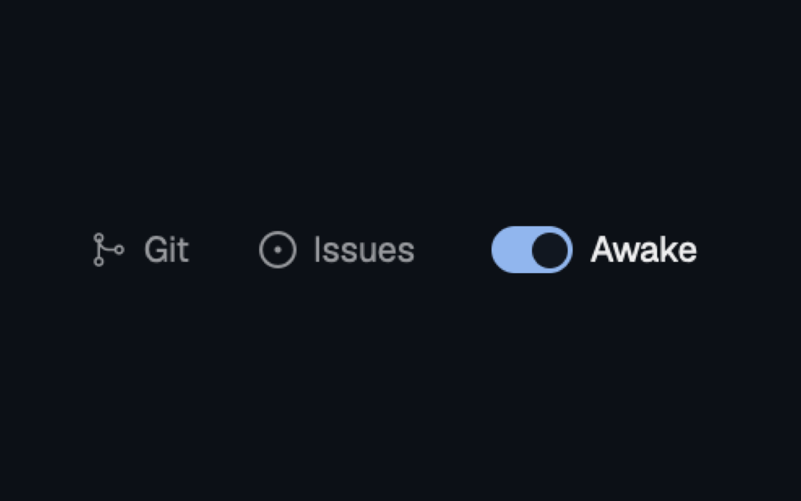

# herdr-keep-awake

A Herdr mod: a switch in the tab bar that keeps your Mac and its display awake while your coding agents work.



## What it does

- **On:** the mod runs `caffeinate -d -i -s` as a hidden Herdr terminal. The display does not sleep,
  and the Mac does not go to sleep on its own.
- **Off:** it ends that `caffeinate`.
- The switch is remembered across restarts. When Herdr quits, the mod ends `caffeinate`. If Herdr
  crashes, `caffeinate -w <Herdr's pid>` ends by itself.
- `cmd-alt-k` flips it from the keyboard.

Closing the lid still puts a Mac to sleep, unless it runs in clamshell mode on power with an
external display.

## Requirements

- **macOS**, for `caffeinate`. It ships with macOS at `/usr/bin/caffeinate`, so there is nothing to
  install; `which caffeinate` confirms it. Linux and Windows have no `caffeinate`: there the switch
  turns red and a toast shows the error.
- **The Herdr desktop app**, whose `hc` (herdr-core) starts and ends `caffeinate`. Tested with
  Herdr 0.1.12.

## Install

Tell your agent in Herdr:

```
Read ~/.config/herdr-app/AGENTS.md, then add this mod: herdr.dev/mods/dominikwozniak/herdr-keep-awake
```

It copies the mod, puts the switch at the right end of your tab bar and merges `cmd-alt-k` into your
keys. The repo works as the address too: `github.com/dominikwozniak/herdr-keep-awake`.

### By hand

```sh
git clone https://github.com/dominikwozniak/herdr-keep-awake
cp -R herdr-keep-awake/mods/keep-awake ~/.config/herdr-app/mods/
herdr-app check ~/.config/herdr-app/mods/keep-awake
```

Then add the switch to your layout. Herdr's built-in layouts are read-only, so on `main` make your own
copy first; it opens at once:

```sh
herdr-app do layout.clone '{"name":"main","as":"my-layout"}'
```

In `~/.config/herdr-app/layouts/my-layout.json`, put this block in your tab bar's row, after the tabs:

```json
{
  "id": "keep-awake",
  "type": "block",
  "content": { "mod": "keep-awake" },
  "size": { "px": 96 },
  "window_drag": true
}
```

If the tab bar is a single `tabs` block, as in `main`, wrap it in a row first:

```json
{
  "id": "tab-bar",
  "type": "row",
  "size": { "px": 42 },
  "resizable": false,
  "children": [
    { "...": "your existing tabs block, without its size" },
    { "...": "the keep-awake block above" }
  ]
}
```

Last, merge `keys.json` into `~/.config/herdr-app/keys.json`, unless `cmd-alt-k` is already yours.

## What it runs

- `hc run` and `hc kill`, to start and end `caffeinate -d -i -s -w <pid>` as a hidden terminal on
  this Mac.
- `sh -c 'echo $PPID'`, once, to read Herdr's pid.
- No network. It reads no files; the switch is saved in Herdr's own `shared.json`.

## Update and uninstall

- **Update:** `git pull` in the clone, then copy `mods/keep-awake` over the installed one again.
  Herdr reloads it.
- **Uninstall:** switch it off, remove the `keep-awake` block from your layout, delete
  `~/.config/herdr-app/mods/keep-awake/` and the `cmd-alt-k` line from `keys.json`.

## Development

Node 22 or later; no dependencies to install. Agents start at `AGENTS.md`.

| command            | what it does                                           |
| ------------------ | ------------------------------------------------------ |
| `pnpm test`        | tests `awake.js` with `node:test`                      |
| `pnpm mod:install` | copies `mods/keep-awake/` into Herdr, which reloads it |

## License

MIT
