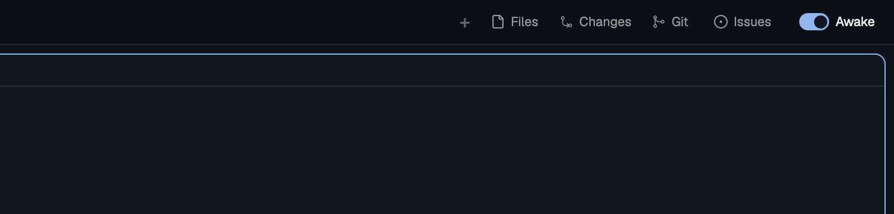

# Keep awake

A small switch at the right end of the tab bar, labelled "Awake". Flip it on and the display
stays on and the Mac awake, so long agent runs keep going while you are away from the keyboard; flip it off
and the Mac sleeps as it normally would. The switch remembers where you left it across restarts, and
`cmd-alt-k` flips it from the keyboard.

## What you see

One block, 96px wide and the tab bar's 42px tall, on the `chrome` background with a 1px `border`
line along its bottom, so it continues the tab bar. Its content sits at the right with 10px of
padding:

- **The button**, 26px tall, 8px side padding, radius 6, 6px gap, 12px type. It gets the `hover`
  background under the pointer and a pointer cursor.
- **The track**, 28×16px, fully rounded: `accent` when on, `input` when off, `blocked` after a
  failure.
- **The knob**, a 12px circle 2px from the track's top: at 14px from its left when on, in
  `accent_foreground`; at 2px when off, in `foreground`.
- **The label** "Awake": `foreground` when on, `muted` when off.

## How it behaves

- Agent statuses do not change it: the switch is the only input.
- A click, or `keep-awake.toggle` (`cmd-alt-k` in `keys.json`), flips the switch. The knob slides in
  150 ms, ease-out.
- On starts the hold: `caffeinate -d -i -s -w <Herdr's pid>` as a hidden hc terminal named
  `keep-awake`. The track turns `accent` once that terminal is live. Off kills it.
- A press on the button does not drag the window, though the block is a `window_drag` area.
- If starting or ending the hold fails, the track turns `blocked` and an error toast says what hc
  answered. The mod tries again only after the switch is flipped.
- Herdr quitting kills the hold. A crash ends it too, since `caffeinate -w` watches Herdr's pid.
- A restart starts the hold again when the switch was left on.

## Built from

- `mods/keep-awake/mod.json`: `{ "place": "none", "title": "Keep awake" }`, so only a layout shows
  it.
- `mods/keep-awake/main.js`: one `View`, default export.
  - `shared("keep-awake.on")` and `setShared` hold the switch; anything but `true` is off.
  - `terminals()` says whether a terminal named `keep-awake` is live. Each render compares that with
    the switch and, when they differ and no start or stop is under way, starts or stops the hold in
    `cx.spawn`.
  - Start: `hc run --bg --json --no-parent --rm --name keep-awake -- caffeinate -d -i -s -w <pid>`.
    Stop: `hc kill keep-awake`. `close()` runs `exec("hc", ["kill", "keep-awake"])` when it is live.
  - The pid: `exec("sh", ["-c", "echo $PPID"])`, read once; without it `-w` is left out.
  - `nextCommand()` in a `cx.spawn` loop receives `"toggle"`.
  - `notify({ level: "error" })` for a failure; `theme()` for every color.
- `mods/keep-awake/awake.js`: the hc arguments, the pid parsing and the `hc ls --json` reading, with
  no imports.
- The layout block, in the tab bar's row after the tabs:
  `{ "id": "keep-awake", "type": "block", "content": { "mod": "keep-awake" }, "size": { "px": 96 }, "window_drag": true }`.
  A layout whose tab bar is a single `tabs` block wraps it in a 42px `row` with this block after it.

## Watch out

- `exec` waits for its program and stops it after 30 s: the hold must run as an hc terminal.
- `pgrep -x Herdr` through `exec` finds nothing; `$PPID` of an `exec`'d shell is the app.
- `terminals()` updates a moment after `hc run` or `hc kill` returns, and two copies of the mod (two
  screens) race on the same name. When `hc run` or `hc kill` fails, ask `hc ls --json`
  (`{ "terminals": [ … ] }`, each with its `name`) before reporting an error, or the loser of the
  race shows a false failure.
- Without `on_mouse_down("left", …stop_propagation())` a press on the switch drags the window.
- Another layout starts its mods fresh: switching to a layout without this block ends the hold.
- macOS only. The lid closed still sleeps the Mac, outside clamshell mode.

## Done when

- `herdr-app check ~/.config/herdr-app/mods/keep-awake` passes and `herdr-app status` lists no
  errors.
- With the switch on, `pgrep -fl "caffeinate -d"` shows `caffeinate -d -i -s -w <pid>` and
  `pmset -g assertions` lists `PreventUserIdleDisplaySleep` from it; off, both are gone.
- `herdr-app do keep-awake.toggle` several times in a row ends with the hold matching the switch and
  no error toast.
- Quitting Herdr with the switch on leaves no `caffeinate -d` running; starting it again brings the
  hold back.
